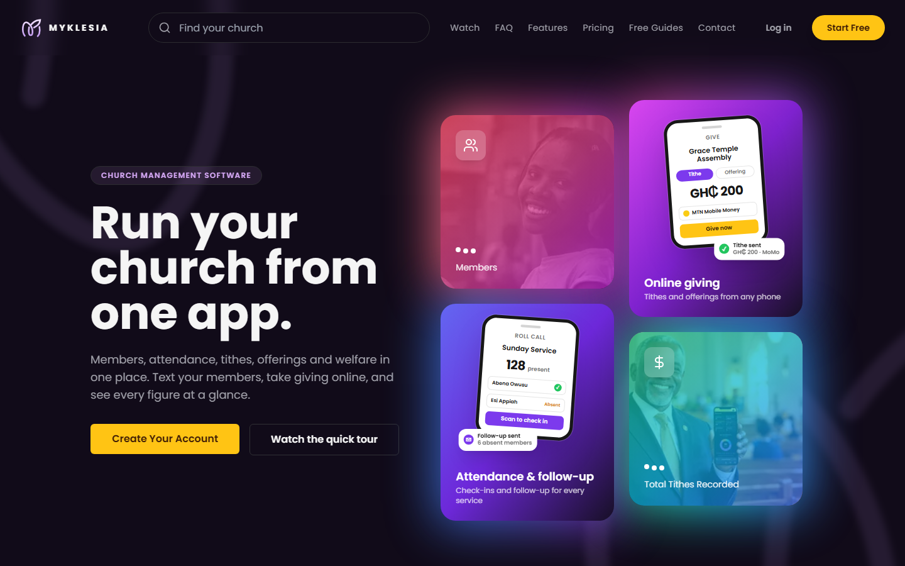
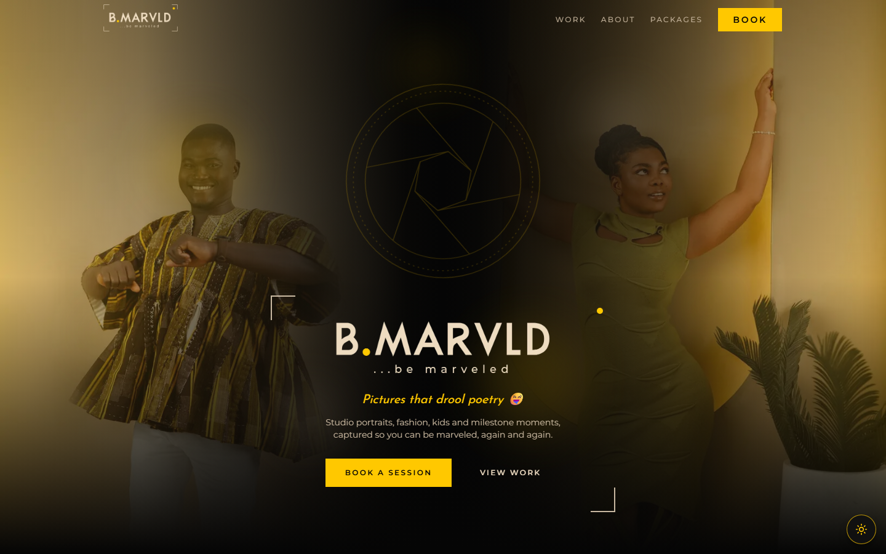
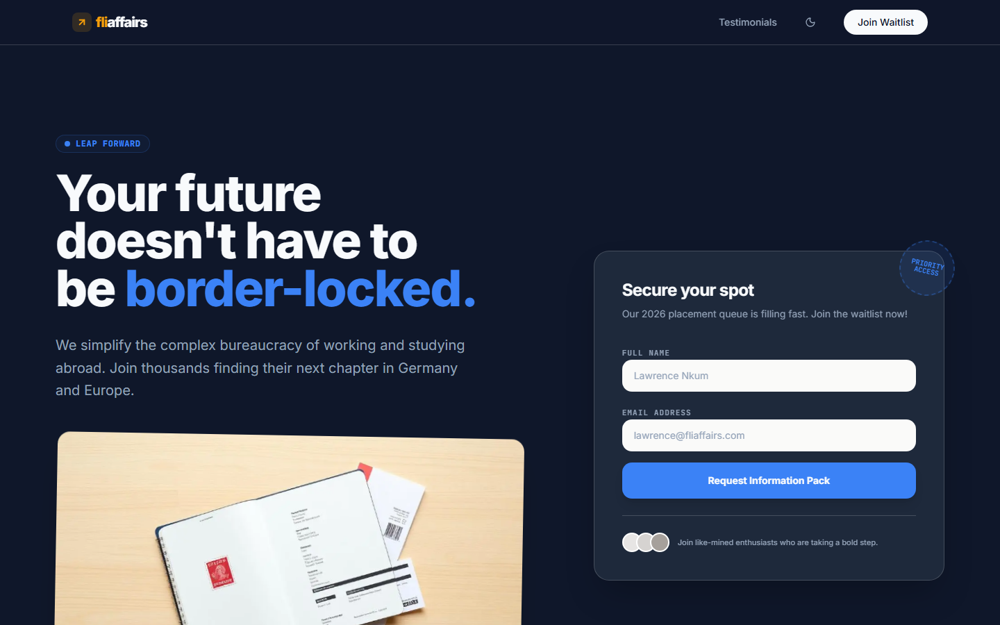

# Collins Marfo

**Full-stack engineer in Accra, Ghana.** I build SaaS products, payment flows and mobile apps from the first commit to production, and I've been shipping software people pay for since 2017. Open to full-time remote roles.

---

## Live products

### [Myklesia](https://myklesia.com) · church management SaaS

Churches run members, attendance, giving and welfare from one app. Used by churches in Ghana and Germany.

- **Multi-tenant:** every church is its own tenant, with subscription plans, free trials and a super-admin console
- **Online giving:** tithes and offerings by mobile money or card through Paystack
- **Roll call:** members check themselves in by scanning a QR code at the door, and absentees get a follow-up
- **Scheduled jobs:** birthday messages, renewal reminders and trial follow-ups run on Upstash QStash, behind a verified request signature
- **Built with:** Next.js, Hono, Prisma, MongoDB, better-auth, Paystack, Resend, QStash

### [B.Marvld Photography](https://bmarvld.com) · bookings, deposits and client galleries

A booking site for a photographer in Accra.

- **No double bookings:** each calendar date is one database record keyed by the date, so only one booking can ever hold it. Picking a date places a 30-minute hold while the client pays a Paystack deposit.
- **Proofing galleries:** each client gets a private link with watermarked previews and picks favourites; a second link delivers the clean, full-size edits
- **Google Drive import:** paste a shared folder link and Cloudinary pulls the photos straight from Drive
- **Passwordless admin:** sign-in by one-time email code
- **Built with:** Next.js, Hono, MongoDB, Paystack, Cloudinary, Google Drive API, Zod

### [Fliaffairs](https://www.fliaffairs.com) · launch page and waitlist

A launch page for a work-and-study-abroad startup, built to test demand before the platform.

- One waitlist form, validated with Zod in the browser and again on the server
- Every sign-up reaches the team as a formatted email built with React Email, with reply-to set to the person who signed up
- **Built with:** Next.js, Hono, React Hook Form, Zod, TanStack Query, React Email, shadcn/ui

### More work

| Project | What it is | Built with |
| --- | --- | --- |
| **Greenimee** | E-commerce with a referral wallet and mobile-money payouts; rebuilt as v2 and migrated live with no downtime | Next.js, Hono, Prisma, better-auth, Paystack |
| **[Onus](https://github.com/kwabena-marfo/onus)** · [live](https://onusbible.vercel.app) | Scripture memorisation: save verses, quiz yourself by book of the Bible and track scores, on web and mobile | Next.js 16, Hono, Prisma, better-auth, Expo |
| **[scrollerCat](https://github.com/kwabena-marfo/scrollercat)** | A Ghana store with "shop-for-me": request any product by link and pay one all-in quote | Next.js, Hono, Prisma, Paystack |

---

## How I build

- **One stack for every app.** 10+ products share one architecture: a Hono API on a single Next.js catch-all route, thin routes, controllers that hold the rules, and Zod at every boundary. A fix in one app carries to all of them.
- **Payments done properly.** Prices come from the server, webhooks are signature-checked, and a single idempotent `fulfill()` means a payment confirmed twice is processed once.
- **AI-assisted, human-reviewed.** I brief coding agents with `AGENTS.md` files, review every diff, and let types, builds and the running app have the final say.

## Get in touch

Hiring a full-stack engineer, or want to talk about something I built? Reach me on [LinkedIn](https://www.linkedin.com/in/kwabenamarfo/) or at [marfobrempong@gmail.com](mailto:marfobrempong@gmail.com).
